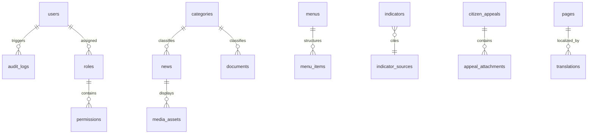

# RƏSMİ İNTERNET PORTALININ TEXNİKİ ARXİTEKTURA VƏ TƏHLÜKƏSİZLİK SPESİFİKASİYASI

**Sifarişçi Dövlət Qurumu:** Naxçıvan Muxtar Respublikasında Azərbaycan Respublikası Prezidentinin Səlahiyyətli Nümayəndəliyi (ARPSN)  
**Rəsmi İnternet Portalı:** https://arpsn.gov.az  
**Sənəd Versiyası:** 3.0 (Bölmələr 9–17 üzrə tam texniki spesifikasiya, qəbul sınaqları və icra planı)  
**Tarix:** Oktyabr 2026  
**Hüquqi Status:** Dövlət informasiya ehtiyatının formalaşdırılması və istismarı üzrə vahid texniki-arxitektura sənədi  

---

## 9. TEXNİKİ ARXİTEKTURA

### 9.1 Tövsiyə Olunan Texnoloji Stek
Portalın yüksək etibarlılığı, ictimai əlçatanlığı, kiber təhlükəsizliyi və axtarış sistemlərində (SEO) qüsursuz indekslənməsi üçün aşağıdakı modul-laylı arxitektura tətbiq olunur:

```
[ İctimai İstifadəçilər / Vətəndaşlar ]
                 │
                 ▼
      [ CDN / Dövlət Şəbəkə WAF ]
      (DDoS qorunması, SSL/TLS HSTS, Edge Caching)
                 │
                 ▼
       [ Nginx Reverse Proxy ]
      (Rate Limiting, Brotli, Statik asset marşrutu)
                 │
        ┌────────┴──────────────────┐
        ▼                           ▼
[ Next.js 14+ Frontend ]   [ Laravel 11 API / CMS ]
(TypeScript, SSR/SSG, SEO) (Modul Monolit, DDD, Auth)
        │                           │
        │                           ├───────────────┐
        │                           ▼               ▼
        │                 [ PostgreSQL 16 ]    [ Redis 7 ]
        │                 (Relasion Baza,      (Micro-cache,
        │                  JSONB, Full-text)    Asinxron Queue)
        │                                           │
        └───────────────────┬───────────────────────┘
                            ▼
             [ S3 Obyekt Saxlama (MinIO/Ceph) ]
             (Vətəndaş sənədləri, PDF, Media arxivləri)
```

#### Komponentlərin Təyinatı:
1. **Frontend Layi (Next.js 14+ / TypeScript):**
   - **SSR / SSG:** Əsas səhifə və daxili bölmələrin Server-Side Rendering və Static Site Generation vasitəsilə 0 ms gecikmə ilə çatdırılması;
   - **SEO:** Dinamik `meta` teqlər, OpenGraph, avtomatik `sitemap.xml`, strukturlaşdırılmış Schema.org JSON-LD;
   - **Əlçatanlıq:** WCAG 2.2 AA standartı, klaviatura naviqasiyası, skrin-rider (NVDA/VoiceOver) dəstəyi.
2. **Backend & İnzibati CMS Core (Laravel 11 Modul Monolit):**
   - Modul strukturu: Məzmun nəşri, Vətəndaş müraciətləri, Media anbarı, İnzibati audit və Rol idarəetməsi;
   - RESTful API və JSON:API standartı;
   - RBAC (Role-Based Access Control) icazə mühərriki.
3. **Verilənlər Bazası (PostgreSQL 16):**
   - Tranzaksiya bütövlüyü (ACID zəmanəti);
   - Məzmun axtarışı üçün daxili Azərbaycan dili orfoqrafiyasına uyğun Tam Mətn Axtarışı (`tsvector`);
   - Müraciət və audit hadisələrinin saxlanması üçün `JSONB` indeksləri.
4. **Keşləmə və Asinxron Növbələr (Redis 7):**
   - Məzmun API sorğularının mikro-keşlənməsi (TTL: 60-300 san);
   - Vətəndaşlara SMS və e-poçt bildirişlərinin asinxron göndəriş növbəsi (`Queue Workers`).
5. **Obyekt Saxlama (S3-compatible MinIO / Ceph):**
   - Vətəndaş müraciətlərinə qoşulan təhlükəsiz PDF/DOCX/JPG fayllarının təcrid olunmuş saxlanması;
   - Fərman, sərəncam və qərarların PDF nüsxələri.
6. **Şəbəkə və Kiber Qorunma (Nginx + WAF / CDN):**
   - TLS 1.3, HSTS preloading, CSP (Content Security Policy);
   - DDoS hücumlarından müdafiə və aparat səviyyəsində sorğu limitləri.

### 9.2 Alternativ Monolit Arxitektura (Laravel Blade)
Əgər layihəni idarə edən komanda vahid mühəndis qrupundan ibarətdirsə və infrastrukturu ən minimal xərclə saxlamaq tələb olunarsa:
- **Server-Rendered Laravel Blade Monolit:**
  - Frontend və Backend vahid Laravel tətbiqi daxilində birləşdirilir;
  - Node.js server tələb olunmur; yalnız Nginx + PHP-FPM + PostgreSQL + Redis kifayət edir;
  - **Qərar Meyarı:** İctimaiyyətin real ziyarətçi trafiki və texniki komandanın dəstək imkanları qiymətləndirilərək ilkin mərhələdə Blade monolit tətbiq edilə, gələcəkdə zərurət yarandıqda Next.js frontend-inə miqrasiya oluna bilər.

### 9.3 Mühitlərin Ayrılması Siyasəti (Environment Segregation)

| Parametr | Production (`prod`) | Staging (`stage`) | Development (`dev`) |
| :--- | :--- | :--- | :--- |
| **Domen / Host** | `arpsn.gov.az` | `staging.arpsn.gov.az` | `dev.arpsn.local` / Docker |
| **Məqsəd** | Canlı ictimai portal | Təsdiq, rəhbərlik baxışı və QA | Lokal tərtibat və vahid testlər |
| **Giriş Hüququ** | Açıq ictimaiyyət | Daxili VPN / IP Whitelist | Yalnız layihə proqramçıları |
| **Debug Rejimi** | `APP_DEBUG=false` | `APP_DEBUG=false` | `APP_DEBUG=true` (Telescope) |
| **Verilənlər Bazası**| PostgreSQL Primary-Replica | Anonimləşdirilmiş QA bazası | Lokal seed / test bazası |
| **Yedəkləmə (Backup)**| Gündəlik avtomatik şifrəli snapshot | Həftəlik snapshot | Tələb olunmur |
| **CI/CD Axını** | Git `main` tag release | Git `release/*` avtomatik deploy | Git `feature/*` lokal qol |

### 9.4 API Versiyalanması və Rate Limiting
- **Versiyalanma Standartı:** Bütün xarici və ictimai sorğular üçün URL prefiksi məcburidir: `/api/v1/...`
- **Rate Limiting:**
  1. *İctimai Məzmun Oxuma (`GET /api/v1/news`, `/documents`):* `120 sorğu / dəqiqə` (IP başına).
  2. *Elektron Müraciət Göndərişi (`POST /api/v1/appeals`):* `5 sorğu / 10 dəqiqə` (IP və FİN üzrə), 120 saniyəlik cooldown.
  3. *Status İzləmə (`GET /api/v1/appeals/{regNo}/status`):* `30 sorğu / dəqiqə`.
  4. *Hədd aşıldıqda:* HTTP `429 Too Many Requests` və `Retry-After: 60`.

---

## 10. VERİLƏNLƏR BAZASI ARXİTEKTURASI

### 10.1 Əsas Cədvəllər (21 Cədvəl üzrə Tam Sxem)
Verilənlər bazasında bütün cədvəllər standart olaraq `id` (BigIncrements / UUID), `created_at`, `updated_at` (zaman damğaları) və silinmələrin bərpası üçün `deleted_at` (Soft Delete) sahələri ilə təchiz edilir. Çoxdilli mətnlər üçün unikal `slug` + `locale` açarı təmin edilir.



#### 1. İstifadəçilər və İcazələr Qrupu:
1. **`users`**
   - Sahələr: `id`, `full_name`, `email` (unique), `password_hash`, `phone`, `mfa_secret` (nullable), `status` (active/suspended), `last_login_at`, `timestamps`, `deleted_at`.
   - İndekslər: `idx_users_email`, `idx_users_status`.
2. **`roles`**
   - Sahələr: `id`, `name` (Superadmin, Redaktor, Təsdiqləyici, Müraciət Operatoru, Auditor), `slug` (unique), `description`, `timestamps`.
3. **`permissions`**
   - Sahələr: `id`, `name`, `slug` (unique), `module` (news, documents, appeals, settings, audit), `timestamps`.
4. **`model_has_roles` / `role_has_permissions`**
   - RBAC əlaqə cədvəlləri (Foreign keys: `role_id`, `permission_id`, `model_id`).

#### 2. Məzmun və Nəşr Qrupu:
5. **`pages`**
   - Sahələr: `id`, `slug` (unique), `template`, `is_published` (bool), `published_at`, `author_id` (FK: users), `timestamps`, `deleted_at`.
6. **`translations`**
   - Sahələr: `id`, `translatable_type`, `translatable_id`, `locale` (az, en, ru), `field`, `content` (longtext/jsonb), `timestamps`.
   - Məhdudiyyət: `unique(translatable_type, translatable_id, locale, field)`.
7. **`categories`**
   - Sahələr: `id`, `slug`, `parent_id` (FK nullable), `type` (news, documents, projects), `sort_order`, `timestamps`, `deleted_at`.
   - Məhdudiyyət: `unique(slug, type)`.
8. **`news`**
   - Sahələr: `id`, `category_id` (FK), `slug`, `image_asset_id` (FK nullable), `is_featured` (bool), `status` (draft, pending, approved, published, archived), `author_id` (FK), `approver_id` (FK nullable), `published_at`, `timestamps`, `deleted_at`.
   - İndekslər: `idx_news_status_published`, `idx_news_slug`.
9. **`projects`**
   - Sahələr: `id`, `slug`, `start_date`, `completion_date`, `budget` (numeric), `status` (ongoing, completed, planned), `sort_order`, `timestamps`, `deleted_at`.
10. **`documents`**
    - Sahələr: `id`, `category_id` (FK), `doc_number`, `doc_date`, `file_asset_id` (FK), `is_active` (bool), `timestamps`, `deleted_at`.
    - İndekslər: `idx_doc_number`, `idx_doc_date`.
11. **`media_assets`**
    - Sahələr: `id`, `disk` (s3/local), `file_path`, `original_name`, `mime_type`, `size_bytes`, `alt_text`, `created_by` (FK), `timestamps`, `deleted_at`.
12. **`banners`**
    - Sahələr: `id`, `title`, `url`, `image_asset_id` (FK), `position` (hero, sidebar, footer), `is_active` (bool), `sort_order`, `timestamps`, `deleted_at`.
13. **`menus`**
    - Sahələr: `id`, `code` (main, top, footer), `name`, `is_active` (bool), `timestamps`.
14. **`menu_items`**
    - Sahələr: `id`, `menu_id` (FK), `parent_id` (FK nullable), `title`, `url`, `route_name`, `target` (_self, _blank), `sort_order`, `is_active`, `timestamps`.

#### 3. Statistika və Göstəricilər Qrupu:
15. **`indicators`**
    - Sahələr: `id`, `source_id` (FK), `slug`, `current_value` (numeric), `unit`, `period_year`, `sort_order`, `timestamps`, `deleted_at`.
16. **`indicator_sources`**
    - Sahələr: `id`, `name` (Dövlət Statistika Komitəsi və s.), `code`, `website_url`, `timestamps`.

#### 4. Vətəndaş Xidmətləri və Müraciətlər Qrupu (Təcrid Olunmuş Şəbəkə Layi):
17. **`citizen_appeals`**
    - Sahələr: `id` (bigint), `reg_number` (unique: `ARPSN-YYYY-XXXX`), `citizen_name`, `citizen_fin_encrypted` (AES-256), `phone`, `email`, `appeal_type` (Ərizə, Şikayət, Təklif, İnformasiya), `subject`, `message` (text), `status` (registered, processing, forwarded, resolved, archived), `internal_routing_note` (text nullable), `responded_at` (timestamp nullable), `legal_retention_until` (timestamp: +5 il), `timestamps`, `deleted_at`.
    - İndekslər: `idx_appeal_reg_number`, `idx_appeal_status`, `idx_appeal_citizen_fin`.
18. **`appeal_attachments`**
    - Sahələr: `id`, `appeal_id` (FK: citizen_appeals), `file_path`, `original_name`, `mime_type`, `size_bytes`, `scan_status` (clean, infected, pending), `timestamps`.
19. **`reception_requests`**
    - Sahələr: `id`, `citizen_name`, `phone`, `official_title`, `requested_date`, `reason` (text), `status` (pending, scheduled, completed, cancelled), `assigned_room`, `timestamps`, `deleted_at`.

#### 5. Sistem İdarəetməsi və Audit Qrupu:
20. **`audit_logs`**
    - Sahələr: `id`, `user_id` (FK nullable), `action` (create, update, delete, login, export), `auditable_type`, `auditable_id`, `old_values` (jsonb), `new_values` (jsonb), `ip_address`, `user_agent`, `hash_signature`, `created_at`.
    - Məhdudiyyət: İnzibati redaktə qadağandır (Append-only table).
21. **`settings`**
    - Sahələr: `id`, `group` (general, contact, social, notification), `key` (unique), `value` (jsonb), `is_public` (bool), `timestamps`.
22. **`redirects`**
    - Sahələr: `id`, `source_url` (unique), `destination_url`, `http_code` (301, 302), `is_active` (bool), `timestamps`.

### 10.2 Vətəndaş Müraciətlərinin Açıq Məzmundan Məntiqi və Fiziki Ayrılması
- **Şəbəkə və Şema Təcridi:** `citizen_appeals`, `appeal_attachments` və `reception_requests` cədvəlləri verilənlər bazasında xüsusi `citizens_secure` şemasında saxlanılır.
- **Giriş Hüququ Məhdudiyyəti:** İctimai API istifadəçisi (`portal_reader`) yalnız `public.*` məzmun cədvəllərinə oxuma hüququna malikdir; vətəndaş məlumatlarına birbaşa oxuma icazəsi tam bloklanıb.
- **Fərdi Məlumatların Şifrələnməsi (Encryption at Rest):** FİN kod, telefon nömrəsi və müraciət mətnləri verilənlər bazasında `pgcrypto` / tətbiq səviyyəsində AES-256-GCM alqoritmi ilə şifrələnərək saxlanılır.

---

## 11. İNFORMASİYA TƏHLÜKƏSİZLİYİ ARXİTEKTURASI

### 11.1 Şəbəkə və Kriptoqrafik Qorunma
1. **TLS / HTTPS:** Yalnız TLS 1.3 və gücləndirilmiş TLS 1.2 protokolları aktivdir. Zəif şifrələr (RC4, 3DES, CBC) bloklanır.
2. **HSTS Preloading:** `Strict-Transport-Security: max-age=63072000; includeSubDomains; preload` başlığı ilə portalın yalnız şifrəli kanalla açılması məcburiləşdirilir.
3. **WAF və Anti-DDoS:** Dövlət internet şəbəkəsi və ModSecurity WAF vasitəsilə SQLi, XSS, RFI/LFI və bot trafikləri filtrasiya edilir.

### 11.2 Giriş Nəzarəti və İcazələr (MFA & RBAC)
1. **MFA (Çoxfaktorlu Autentifikasiya):** İnzibati idarəetmə panelinə daxil olan bütün redaktor və idarəçilər üçün Time-based One-Time Password (TOTP / Google Authenticator) və ya ASAN İmza məcburidir.
2. **Ən Az İmtiyaz Prinsipi (Least Privilege):** Hər bir əməkdaş yalnız öz vəzifə səlahiyyətinə uyğun məlumatları görür (məsələn: Xəbər redaktoru vətəndaş müraciətlərini görə bilməz; Müraciət operatoru isə sistem sazlamalarını dəyişə bilməz).

### 11.3 Tətbiq Səviyyəsində Təhlükəsizlik
1. **CSRF Müdafiəsi:** Bütün POST/PUT/DELETE sorğularında `X-CSRF-TOKEN` yoxlanışı və `SameSite=Strict` cookie bayraqları təmin edilir.
2. **XSS Müdafiəsi:** Bütün istifadəçi daxilolmaları HTML-entity səviyyəsində təmizlənir (`htmlspecialchars`), Content-Security-Policy (CSP Level 3) icazəsiz kənar skriptlərin icrasını qadağan edir.
3. **SQL Injection Müdafiəsi:** Verilənlər bazası ilə bütün əlaqələr PDO Prepared Statements və ORM parametr əlaqələndirməsi vasitəsilə həyata keçirilir.
4. **Təhlükəsiz Sessiya/Cookie:** Sessiya kukiləri `HttpOnly`, `Secure`, `SameSite=Strict` bayraqları ilə qorunur; 15 dəqiqə fəaliyyətsizlikdən sonra sessiya avtomatik bağlanır.
5. **Fayl Yoxlaması və Təhlükəsizliyi:**
   - Vətəndaş müraciətlərində yalnız `.pdf`, `.docx`, `.doc`, `.jpg`, `.png` formatlarına icazə verilir;
   - Bütün yüklənən fayllar ilkin olaraq karantin qovluğuna düşür və ClamAV antivirus mühərriki ilə skan edildikdən sonra S3 anbarına köçürülür;
   - İcra olunan (.exe, .bat, .sh, .cmd, .zip, .rar) fayllar avtomatik rədd edilir.

### 11.4 Audit, SIEM və Zəiflik İdarəetməsi
1. **Dəyişdirilməz Audit Jurnalı:** Bütün inzibati hərəkətlər (giriş, redaktə, silmə, status dəyişməsi, məlumat çıxarışı) unikal SHA-256 zənciri ilə imzalanaraq audit jurnalına yazılır.
2. **SIEM İnteqrasiyası:** Xətalar və şübhəli fəaliyyət hadisələri dərhal Syslog/CEF formatında dövlət monitorinq və SIEM mərkəzinə ötürülür.
3. **Müntəzəm Patching və OWASP ASVS Uyğunluğu:**
   - Server əməliyyat sistemi və paketlər aylıq təhlükəsizlik yenilənmələrindən keçirilir;
   - OWASP ASVS (Application Security Verification Standard) L2 tələblərinə uyğun olaraq buraxılış öncəsi nüfuzetmə testi (Penetration Testing) aparılır;
   - **Kritik və ya yüksək dərəcəli zəiflik aradan qaldırılmadan portalın istismara qəbulu qəti qadağandır.**

### 11.5 Fərdi Məlumatların İşlənməsi və Saxlanma Hüququ
1. **Hüquqi Əsas:** Fərdi məlumatların toplanması və işlənməsi “Fərdi məlumatlar haqqında” və “Vətəndaşların müraciətləri haqqında” Azərbaycan Respublikasının Qanunları əsasında icra edilir.
2. **Vətəndaşın Məlumatlandırılması:** Elektron müraciət və qəbul formalarında məlumatların işlənməsi məqsədi və məxfilik təminatı barədə məcburi razılıq bəndi yerləşdirilir.
3. **Saxlanma və Məhv Etmə:** Müraciət məlumatları qanunvericiliklə müəyyən edilmiş 5 il müddətində arxivləşdirilir. Müddət bitdikdən sonra məlumatlar kriptoqrafik məhv etmə (Cryptographic Shredding) protokolu ilə daimi silinir.
4. **Server və Domen Hüquqları:** `arpsn.gov.az` domen adı, DNS zonaları, server avadanlıqları, verilənlər bazası və bütün ehtiyat nüsxələrinin mülkiyyət və idarəetmə hüquqları **müstəsna olaraq Sifarişçiyə (ARPSN)** aiddir. Podratçı təşkilatda heç bir asılılıq saxlanıla bilməz.

---

## 12. PERFORMANS, SEO VƏ ƏLÇATANLIQ

### 12.1 Hədəf Göstəriciləri (SLA və Core Web Vitals)
- **Əlçatanlıq (Uptime SLA):** İllik **99.9%** dayanıqlılıq.
- **Mobil Core Web Vitals (75-ci persentil):**
  - **LCP (Largest Contentful Paint):** ≤ 2.5 saniyə;
  - **INP (Interaction to Next Paint):** ≤ 200 millisaniyə;
  - **CLS (Cumulative Layout Shift):** ≤ 0.1;
  - **TTFB (Time to First Byte):** ≤ 300 millisaniyə.

### 12.2 Şəkillərin Optimizasiyası və Keşləmə
- Bütün vizual fayllar avtomatlaşdırılmış konvertasiya borusu vasitəsilə növbəti nəsil **WebP** və **AVIF** formatlarına çevrilir;
- Bütün məzmun şəkillərində `loading="lazy"` və brauzer layout sıçrayışlarının qarşısını almaq üçün təyin edilmiş `width` və `height` atributları istifadə olunur;
- Statik resurslar üçün `Cache-Control: public, max-age=31536000, immutable` tətbiq edilir.

### 12.3 Axtarış Sistemi Optimizasiyası (Texniki SEO)
- **`sitemap.xml`:** Avtomatik generirlənən, prioritet və son dəyişmə tarixlərini özündə əks etdirən çoxdilli xəritə;
- **`robots.txt`:** Axtarış robotları üçün düzgün indeksləmə direktivləri və daxili bölmələrin qorunması;
- **Kanonik Ünvanlar:** Bütün səhifələrdə `<link rel="canonical">` teqi;
- **Beynəlxalq Uyğunluq:** Azərbaycan, İngilis və Rus dilləri üçün `<link rel="alternate" hreflang="...">` təyinatları;
- **Sosial Paylaşım:** Bütün dinamik səhifələrdə OpenGraph və Twitter Card meta verilənləri;
- **Strukturlaşdırılmış Verilənlər:** Schema.org `GovernmentOrganization`, `WebSite` və `BreadcrumbList` JSON-LD işarələməsi.

### 12.4 Yük Testləri və İstifadəçi Tutumu
- Portalın eyni vaxtda qəbul edə biləcəyi istifadəçi sayı və maksimal sorğu tezliyi (RPS) layihənin təhvil-təslim mərhələsində Sifarişçi ilə təsdiqlənmiş yük ssenariləri (məsələn: 10,000 eyni vaxtda aktiv vətəndaş / 500 RPS) əsasında Apache JMeter / k6 vasitəsilə stres-testdən keçirilir.

### 12.5 WCAG 2.2 AA Əlçatanlıq Standartı
- **Kontrast Nisbəti:** Mətn və arxa fon arasında ən azı 4.5:1 kontrast (Dövlət göyü `#082B48`, qızılı `#B99755`);
- **Klaviatura Naviqasiyası:** Siçansız idarəetmə üçün aydın görünən `focus-visible` konturları (3px qızılı haşiyə);
- **Alternativ Mətnlər:** Bütün şəkillər, gerb və infoqrafikalar üçün məzmunu tam təsvir edən `alt` mətnləri;
- **Ekran Oxuyucu Dəstəyi:** ARIA etiketləri (`aria-label`, `aria-expanded`, `aria-roledescription`);
- **Form Xətalarının İzahı:** Giriş sahələrində buraxılmış səhvlərin anında qırmızı indikator və anlaşıqlı izahat mətni ilə təqdim edilməsi;
- **Hərəkət Həssaslığı:** `prefers-reduced-motion: reduce` rejiminə tam hörmət.

---

## 13. İNFRASTRUKTUR VƏ EHTİYAT NÜSXƏLƏMƏ (BACKUP)

### 13.1 Yerləşmə və Server İnfrastrukturu
1. **Milli Dövlət Buludu:** Portal Azərbaycan Respublikasının Rəqəmsal İnkişaf və Nəqliyyat Nazirliyinə məxsus **AzInTelecom Dövlət Buludunda (G-Cloud)** və ya Dövlət Təhlükəsiz Şəbəkəsində (DMX / Xüsusi Rabitə və İnformasiya Təhlükəsizliyi Dövlət Xidməti) yerləşdirilir.
2. **Konteynerləşdirmə və Klaster:**
   - İstehsalat mühiti Docker konteynerlərində və yüksək əlçatanlıqlı Kubernetes / Docker Swarm orkestrasiyası ilə idarə olunur;
   - Veb serverlər üçün avtomatik miqyaslanma (Auto-scaling) tənzimlənir.

### 13.2 Ehtiyat Nüsxələmə Siyasəti (3-2-1 Qaydası)
Portalın məlumat itkisindən tam sığortalanması üçün 3-2-1 ehtiyat nüsxələmə strategiyası tətbiq olunur:
- **3 Nüsxə:** 1 canlı işçi baza + 2 müstəqil ehtiyat nüsxə;
- **2 Fərqli Daşıyıcı:** NVMe SSD server diski + təcrid olunmuş S3 obyekt saxlama anbarı;
- **1 Coğrafi Uzaq Mərkəz:** Naxçıvan və Bakı data mərkəzləri arasında coğrafi nüsxələmə.

```
┌────────────────────────────────────────────────────────┐
│               PostgreSQL 16 Primary                    │
└──────────────────────────┬─────────────────────────────┘
                           │
             ┌─────────────┴─────────────┐
             ▼                           ▼
┌─────────────────────────┐ ┌────────────────────────────┐
│ Gündəlik Tam Snapshot   │ │ Davamlı WAL Arxivlənməsi   │
│ (Hər gecə saat 02:00,   │ │ (Hər 15 dəqiqədən bir,     │
│  AES-256 şifrələnmiş)   │ │  Point-in-Time Recovery)   │
└────────────┬────────────┘ └────────────┬───────────────┘
             │                           │
             └─────────────┬─────────────┘
                           ▼
┌────────────────────────────────────────────────────────┐
│     Təcrid Olunmuş Georeplikasiyalı S3 Anbarı          │
│            (Bakı & Naxçıvan Data Mərkəzi)              │
└────────────────────────────────────────────────────────┘
```

### 13.3 Fəlakətdən Bərpa Parametrləri (Disaster Recovery RTO & RPO)
- **RTO (Recovery Time Objective):** Maksimum **2 saat**. Fövqəladə texniki qəza və ya qlobal nasazlıq baş verdikdə portalın bütün funksionallığı ən geci 2 saat ərzində alternativ serverdə tam bərpa edilməlidir.
- **RPO (Recovery Point Objective):** Maksimum **15 dəqiqə**. WAL (Write-Ahead Logging) arxivlənməsi sayəsində baş verə biləcək ən böyük verilənlər itkisi 15 dəqiqəni aşa bilməz.
- **Rüblük Sınaq Qaydası:** Hər rübün sonunda ehtiyat nüsxələrin bərpa olunma qabiliyyəti test serverində praktiki simulyasiya edilərək rəsmi aktla təsdiqlənir.

---

## 14. QƏBUL SINAQLARI (ACCEPTANCE TESTING & QA)

### 14.1 Sınaq Sahələri və Funksional Meyarlar
Portalın istismara təhvil verilməsi üçün aşağıdakı sınaqlar hərtərəfli icra olunur:

1. **Bütün Səhifə və Menyular:**
   - Əsas və daxili 7 bölmə (Nümayəndəlik, Fəaliyyət, Sənədlər, Naxçıvan, Media, Vətəndaşlar üçün, Əlaqə), alt keçidlər və 404 səhifəsinin qüsursuz işləməsi;
   - Naviqasiya iyerarxiyası və breadcrumb marşrutlarının tamlığı.
2. **Çoxdilli Dil Keçidi (AZ / EN / RU):**
   - Dil dəyişdirildikdə cari səhifə kontekstinin qorunması;
   - Bütün statik və dinamik məzmun elementlərinin, cədvəllərin və bildirişlərin seçilmiş dildə düzgün əks olunması.
3. **Qlobal Axtarış Mexanizmi:**
   - Xəbərlər, layihələr və rəsmi sənədlər üzrə açar söz, nömrə və kateqoriya əsaslı sürətli axtarış və nəticələrin dəqiq göstərilməsi.
4. **Mobil və Çoxqurğulu Görünüş (Cross-Device & Responsive UI):**
   - Mobil (iOS Safari, Android Chrome), planşet və fərqli masaüstü ekran ölçülərində (1366px, 1920px, 4K) maketin pozulmaması;
   - Mobil menyunun erqonomikliyi və sensor idarəetmə dəstəyi.
5. **CMS CRUD və Təsdiq İş Axını:**
   - Məzmunun yaradılması, redaktəsi, silinməsi və 5 mərhələli iş axını: *Qaralama → Yoxlama → Təsdiq → Dərc → Arxiv*;
   - Rollar (Superadmin, Redaktor, Təsdiqləyici, Müraciət Operatoru, Auditor) arasında icazə sərhədlərinin qorunması.
6. **Təhlükəsiz Fayl Yükləmə və Yoxlama:**
   - İcazə verilən formatların (.pdf, .docx, .doc, .jpg, .png; maks 5 MB) düzgün qəbulu;
   - Qadağan olunmuş icra edilən və arxiv fayllarının (.exe, .bat, .cmd, .zip, .rar) dərhal bloklanması;
   - Karantin və ClamAV antivirus skanının test edilməsi.
7. **Rəsmi Sənəd Filtrləri və Axtarış:**
   - Sənəd növü (Fərman, Sərəncam, Qərar), qəbul ili/tarixi və rəsmi nömrə üzrə real vaxt filtrlənməsi və PDF nüsxələrin endirilməsi.
8. **Elektron Müraciətlərin Təhlükəsiz Qəbulu və Status İzləmə:**
   - FİN kodu, telefon və e-poçt format yoxlaması, məxfilik razılığı;
   - Spam və botlara qarşı 120 saniyəlik cooldown limiti;
   - Unikal `ARPSN-YYYY-XXXX` qeydiyyat qəbzinin (talon) formalaşdırılması və çap rejimi;
   - 4 mərhələli status izləmə mexanizminin (*Qeydiyyat → İlkin baxış və yönləndirmə → İcraatda → Cavablandırıldı*) real vaxt rejimində işləməsi.
9. **E-poçt və SMS Bildirişləri:**
   - Müraciət qeydə alındıqda və status dəyişdikdə vətəndaşa və məsul şöbəyə təhlükəsiz SMTP və SMS şlüzü ilə avtomatik bildirişlərin çatdırılması.
10. **Axtarış Motoru Optimizasiyası (SEO):**
    - `robots.txt`, `sitemap.xml`, `<link rel="canonical">`, OpenGraph, Twitter Card və Schema.org JSON-LD teqlərinin axtarış sistemlərinin validatorlarında xətasız keçməsi.
11. **Klaviatura və Əlçatanlıq Sınağı (WCAG 2.2 AA):**
    - Siçansız yalnız `Tab`, `Shift+Tab`, `Enter`, `Space`, `Esc` düymələri ilə tam idarəolunma;
    - 3px qızılı fokus konturu, skip link, rəng kontrastı (≥ 4.5:1), skrin-rider (NVDA/VoiceOver) uyğunluğu.
12. **Audit və Təhlükəsizlik Jurnalları:**
    - Bütün inzibati hərəkətlərin IP ünvanı, istifadəçi və zaman damğası ilə dəyişdirilməz loqlanması.
13. **Ehtiyat Nüsxədən Bərpa (Backup / Restore Drill):**
    - Test mühitində verilənlər bazası və media arxivinin son nüsxədən tam bərpa edilməsi testi.
14. **Yük (Stress) və Penetrasiya Testləri:**
    - Eyni vaxtda 10,000 istifadəçi / 500 RPS yük altında Apache JMeter / k6 testi;
    - OWASP ASVS L2 tələblərinə uyğun xarici penetrasiya testi; sıfır kritik/yüksək zəiflik təsdiqi.

### 14.2 Qəbul-Təhvil Sənədləri
- **Dövlət Qəbul-Təhvil Protokolu:** Sifarişçi və icraçı tərəfindən imzalanan rəsmi yekun təhvil aktı;
- **Sınaq Nəticələri Aktları (Test Execution Reports):** Bütün funksional, təhlükəsizlik və yük sınaqlarının nəticə protokolları;
- **Uyğunsuzluqlar və Düzəliş Reyestri (Bug & Remediation Register):** Test zamanı aşkar edilmiş bütün iradlar və onların aradan qaldırılma statusu.

---

## 15. TƏHVİL VERİLƏN MATERİALLAR (DELIVERABLES)

Layihənin yekununda Sifarişçiyə (ARPSN) tam həcmdə aşağıdakı materiallar təhvil verilir:

1. **Mənbə Kodu və Git Repozitoriyası:**
   - Şərh edilmiş, standartlara uyğun təmiz frontend və backend mənbə kodu;
   - Bütün dəyişikliklərin tarixçəsini özündə saxlayan rəsmi Git repozitoriyası (`main` branch tag).
2. **Verilənlər Bazası Migrasiyaları və Sxem:**
   - Bütün 21 cədvəl üçün miqrasiya skriptləri, ilkin ilkin seed məlumatları, xarici açar və indeks tərifləri, tam ER diaqramı.
3. **Konfiqurasiya və Gizli Açar İdarəetməsi (.env.example & Secrets):**
   - İstehsalat, sınaq və inkişaf mühitləri üçün `.env.example` şablonları;
   - Gizli açarların (API keys, baza şifrələri, JWT secret, MFA tokenləri) təhlükəsiz saxlanması və rotasiya qaydaları.
4. **Deploy və Rollback Təlimatı:**
   - Docker konteynerlərinin qurulması, CI/CD borusunun işə salınması və kritik xəta zamanı əvvəlki stabil nüsxəyə (Rollback) qayıtma addımları.
5. **API Spesifikasiyası və Sənədləşmə:**
   - OpenAPI 3.0 / Swagger rəsmi spesifikasiya faylı və sınaqlar üçün Postman kolleksiyası.
6. **CMS İstifadəçi və İnzibatçı Təlimatı:**
   - Redaktorlar, təsdiqləyicilər və sistem administratorları üçün addım-addım illüstrasiyalı Azərbaycan dilində PDF bələdçi.
7. **Dizayn Faylları və Komponent Kitabxanası:**
   - Figma UI/UX dizayn sistemi, rəng palitrası, tipoqrafika təlimatı, dövlət gerbinin rəsmi vektor faylları və ikonlar dəsti.
8. **Sınaq və Təhlükəsizlik Hesabatları:**
   - Yük testlərinin analitik hesabatı, OWASP təhlükəsizlik auditi və penetrasiya sınağı rəyi, WCAG 2.2 AA audit nəticələri.
9. **Backup və Fəlakətdən Bərpa Təlimatı:**
   - Gündəlik avtomatlaşdırılmış şifrəli backup və PITR (Point-in-Time Recovery) vasitəsilə bazanın bərpası üzrə texniki təlimat.
10. **Domen, DNS və İnzibatçı Çıxışları:**
    - `arpsn.gov.az` domeni, DNS zonası, SSL sertifikatı, server hostinqi və obyekt saxlancının tam inzibatçı (Root/Admin) giriş məlumatları.
11. **Zəmanət və Texniki Dəstək Şərtləri:**
    - 12 aylıq qüsurların pulsuz aradan qaldırılması zəmanəti, SLA müqaviləsi və kritik insidentlər üçün 24/7 əlaqə reqlamenti.

---

## 16. İCRA MƏRHƏLƏLƏRİ VƏ TƏQVİM PLAN

Layihə 7 ardıcıl mərhələ üzrə icra edilir:

| Mərhələ | Fəaliyyət Sahəsi | Müddət | Nəticə və Təhvil Məhsulu |
| :--- | :--- | :--- | :--- |
| **I. Analiz və Təsdiq** | Texniki tapşırığın dəqiqləşdirilməsi, tələblərin analizi və arxitektura razılaşdırılması | 5 iş günü | Təsdiq edilmiş Texniki Tapşırıq və arxitektura sənədi |
| **II. UI/UX və Prototip** | Dizayn sistemi, ana və daxili səhifələrin maketləri, kliklənən interaktiv prototip | 10 iş günü | Figma dizayn maketi və təsdiq olunmuş UI konsepti |
| **III. CMS və Backend** | Verilənlər bazası migrasiyaları, RBAC icazələri, məzmun nəşr axını, RESTful API | 15 iş günü | Funksional CMS nüvəsi və idarəetmə arxitekturası |
| **IV. Frontend və Daxili Səhifələr**| Responsive interfeys, 7 daxili bölmə, axtarış, sənəd filtrləri, müraciət formaları, WCAG əlçatanlığı | 15 iş günü | İnteqrasiyaya hazır tam frontend tətbiqi |
| **V. İnteqrasiyalar** | E-poçt (SMTP), SMS şlüzü, ClamAV fayl skanı, S3 bulud anbarı və xarici dövlət xidmətləri | 10 iş günü | Əlaqələndirilmiş işlək inteqrasiya şəbəkəsi |
| **VI. Təhlükəsizlik və Qəbul Sınaqları** | Funksional testlər, yük testi, OWASP ASVS L2 pen-test, qüsurların aradan qaldırılması | 10 iş günü | Sınaq aktları və Qəbul-təhvil protokolu |
| **VII. Buraxılış və Təlim** | Canlı serverə yerləşdirmə, domen keçidi, CMS istifadəçilərinə təlim keçirilməsi və təhvil | 5 iş günü | Canlı istismarda olan portal və təlim sertifikatları |

*Qeyd:* Yuxarıda göstərilən müddətlər ilkin qiymətləndirmədir. Xarici dövlət sistemləri ilə inteqrasiyaların yekun siyahısı və daxil ediləcək ilkin arxiv məzmununun həcmi dəqiqləşdikcə təqvim planı Sifarişçi ilə qarşılıqlı razılaşma əsasında yenilənir.

---

## 17. TƏSDİQ TƏLƏB EDƏN AÇIQ MƏSƏLƏLƏR

Layihənin icrasının növbəti mərhələlərinə keçid üçün Sifarişçi (ARPSN) tərəfindən rəsmi təsdiqi tələb olunan məsələlər:

1. **Prezident Sitatının Mənbəyi və Rəsmi Portret:**
   - Masthead blokunda yer alan Azərbaycan Respublikasının Prezidenti cənab İlham Əliyevin Naxçıvanla bağlı rəsmi sitatının mənbə mətni və dövlət protokoluna uyğun təsdiqlənmiş yüksək keyfiyyətli rəsmi portret fotosunun təqdim edilməsi.
2. **Dövlət Gerbinin İstifadə Qaydası:**
   - Portalın başlığında və rəsmi elektron talonlarda Dövlət Gerbinin istifadə standartı, rəsmi vektor faylı və ölçü nisbətlərinin təsdiqi.
3. **Saytın İnformasiya Sahibi və Məsul Operatorları:**
   - Portalın hüquqi informasiya sahibi (ARPSN rəhbərliyi) və gündəlik məlumatların yenilənməsinə məsul olan struktur bölmələrin (Mətbuat xidməti, Sənədlərlə iş və vətəndaş müraciətləri şöbəsi) rəsmi təyinatı.
4. **Domen və Hostinq Yerləşmə Məkanı:**
   - `arpsn.gov.az` domeninin DNS zonası, SSL sertifikatlarının təminatı və hostinqin yerləşdiriləcəyi dövlət data mərkəzinin (AzInTelecom G-Cloud və ya DMX qapalı şəbəkəsi) təsdiqi.
5. **Rəsmi Telefon, E-poçt və Vətəndaş Qəbulu Cədvəli:**
   - Saytda dərc olunacaq rəsmi əlaqə nömrələri, dəftərxana e-poçt ünvanları və rəhbər şəxslərin (Səlahiyyətli Nümayəndə, müavin, şöbə müdirləri) rəsmi vətəndaş qəbulu gün və saatlarının yekun təsdiqi.
6. **AZ / EN / RU Dilləri üzrə Tərcümə Məsuliyyəti:**
   - Xarici dilli (İngilis və Rus) səhifələrin məzmun tərcümələrinin Nümayəndəliyin daxili əməkdaşları tərəfindən və ya kənar peşəkar tərcümə xidməti vasitəsilə icrası qaydasının müəyyənləşdirilməsi.
7. **Elektron Müraciətlərin Hüquqi Proseduru və İnteqrasiyası:**
   - Elektron müraciətlərin birbaşa portalın daxili CMS operatorları tərəfindən idarə edilməsi və ya mövcud Dövlət Elektron Sənəd Dövriyyəsi Sistemi ilə avtomatlaşdırılmış API inteqrasiyası modelinin seçilməsi.
8. **Statistika və Göstəricilərin Mənbələri:**
   - "Naxçıvan rəqəmlərdə" interaktiv blokunda nümayiş olunan regional iqtisadi, sosial və demoqrafik rəqəmlərin Naxçıvan MR Dövlət Statistika Komitəsi və müvafiq nazirliklərlə dövri (rüblük/illik) yenilənmə reqlamenti.
9. **İlkin Məzmun Arxivinin Həcmi:**
   - Portal canlı istismara buraxılmazdan əvvəl bazaya daxil ediləcək keçmiş xəbərlərin, rəsmi fərman və sərəncamların, eləcə də inkişaf layihələrinin tarixi əhatə dairəsi (məsələn: son 1 və ya 2 il).
10. **Xidmət Səviyyəsi (SLA) və Texniki Dəstək Müddəti:**
    - Layihə təhvil verildikdən sonra zəmanət müddətinin (12 ay) və növbəti dövrlər üçün texniki dəstək və sistem müşayiəti müqaviləsinin şərtlərinin razılaşdırılması.
